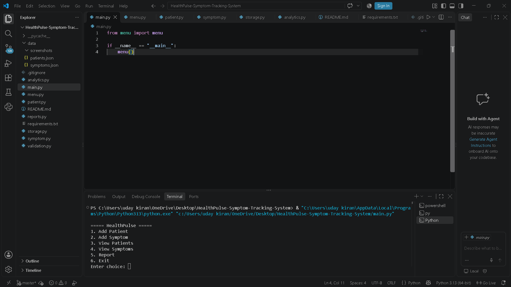
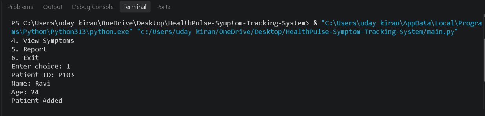
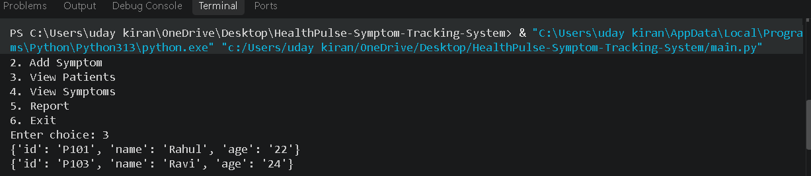
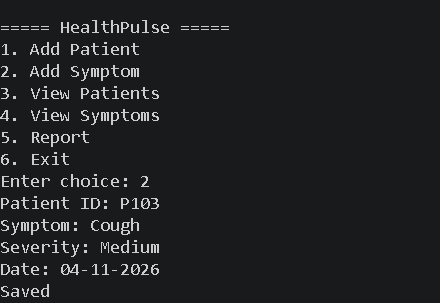
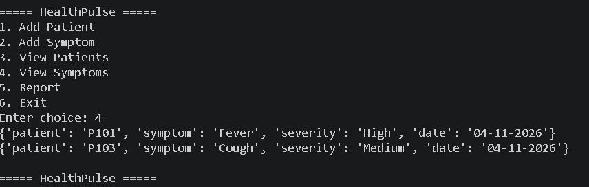
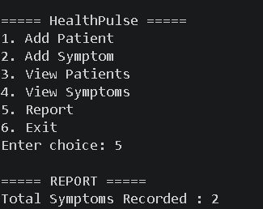

# 🏥 HealthPulse – Symptom Tracking System

A Python-based console application for managing patient health records and tracking symptoms using JSON file storage.

## 🚀 Features

- Add Patient
- View Patients
- Add Symptom
- View Symptoms
- Generate Report
- JSON File Storage

## 🛠️ Technologies Used

- Python 3
- JSON
- VS Code
- Git
- GitHub

## ▶️ How to Run

```bash
py main.py
```

## 📸 Screenshots

### Home Screen


### Add Patient


### View Patients


### Add Symptom


### View Symptoms


### Report


## 👨‍💻 Author

**Uday Kiran V**